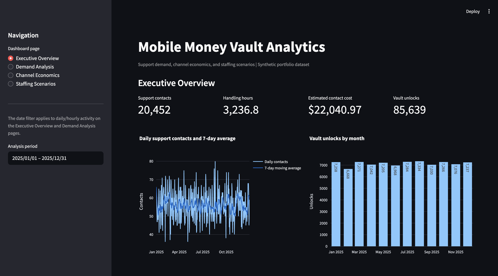
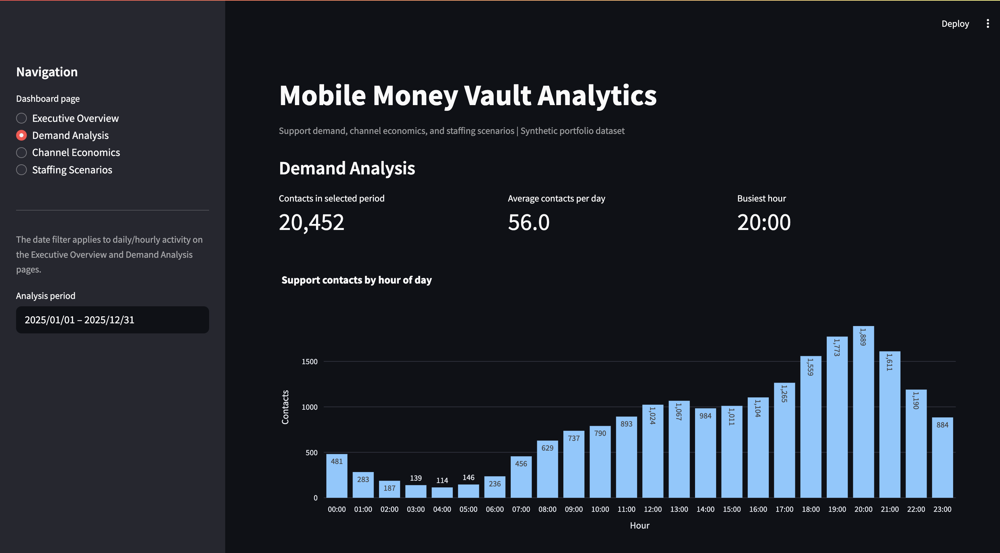
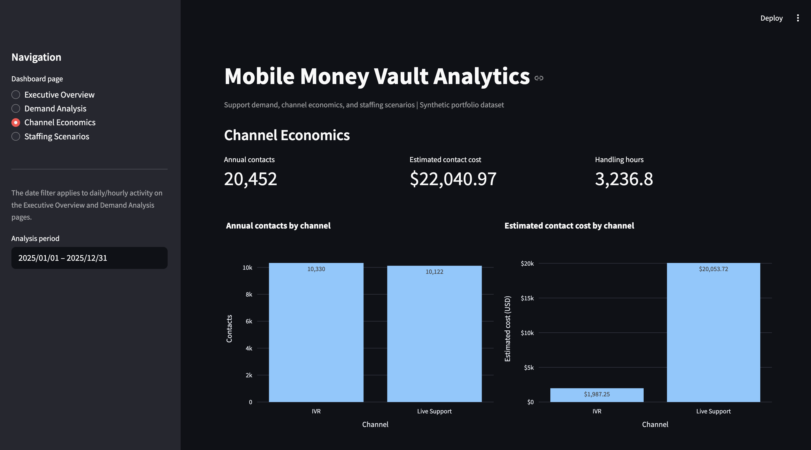
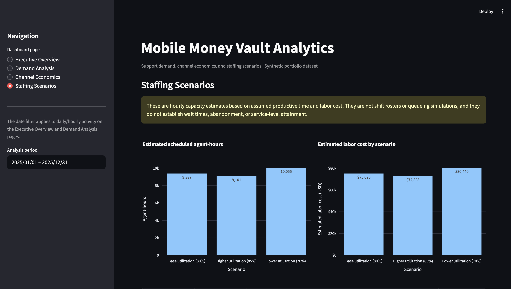

# Mobile Money Vault Analytics & Support Cost Optimization

An interactive Python and Streamlit portfolio project analyzing synthetic mobile-money vault activity, support demand, channel economics, and staffing capacity scenarios.

> **Data notice:** All records in this project are synthetic and created for portfolio demonstration. They are not Wave data, customer records, or actual company operating metrics. Cost figures are assumption-based estimates.

## Dashboard

The Streamlit application has four sections:

1. **Executive Overview:** selected-period support and vault-unlock KPIs, daily support activity, a seven-day moving average, monthly vault unlocks, and annual channel mix.
2. **Demand Analysis:** hourly contact patterns, average daily contacts by weekday, daily trends, a weekday-by-hour heatmap, and downloadable activity data.
3. **Channel Economics:** annual contacts, estimated contact costs, average handling time, channel comparisons, and a downloadable channel summary.
4. **Staffing Scenarios:** alternative utilization assumptions, estimated agent-hours, modeled labor costs, and a downloadable scenario comparison.

### Dashboard screenshots

The screenshots below are stored in the repository under `assets/`.

#### Executive Overview


#### Demand Analysis


#### Channel Economics


#### Staffing Scenarios


## Project objectives

- Summarize vault unlock activity and support contact volumes.
- Identify when support demand is highest by hour and weekday.
- Compare IVR and live-support channels using contact volume, handling time, and modeled contact costs.
- Explore how different agent-utilization assumptions affect estimated staffing capacity and labor cost.
- Present operational findings in an interactive dashboard while making assumptions and analytical limitations explicit.

## Data and methodology

The dashboard reads four CSV files from the `data/` directory:

| File | Purpose |
|---|---|
| `daily_unlocks_2025.csv` | Daily vault unlock counts and unlock-channel breakdown |
| `hourly_support_demand.csv` | Hourly support contacts, handling time, estimated contact cost, and customer counts |
| `channel_cost_summary.csv` | Annual channel-level contacts, handling time, and estimated contact costs |
| `staffing_scenario_comparison.csv` | Alternative staffing utilization and labor-cost estimates |

The application uses **pandas** to load, clean, filter, and aggregate the CSV data. **Plotly** generates the interactive charts, and **Streamlit** provides the dashboard interface and downloadable CSV outputs.

The daily support trend includes a seven-day moving average. The moving average is calculated over the complete daily series before the selected display period is applied, so the first displayed days retain their preceding history.

The date filter applies to daily and hourly activity on the Executive Overview and Demand Analysis pages. Channel economics and staffing scenario tables are annual summaries and remain based on the full-year 2025 data.

## Selected findings from the synthetic 2025 dataset

| Metric | Result |
|---|---:|
| Vault unlocks | 85,639 |
| Support and IVR contacts | 20,452 |
| Total handling time | 3,236.8 hours |
| Estimated channel contact cost | $22,040.97 |
| Busiest support hour | 20:00 |
| Highest-volume weekday by average daily contacts | Friday |

### Channel comparison

- IVR accounted for 10,330 contacts, approximately 50.5% of all contacts. Its modeled average handling time was 4.02 minutes per contact.
- Live Support accounted for 10,122 contacts, approximately 49.5% of all contacts. Its modeled average handling time was 15.08 minutes per contact.
- Under the project's synthetic cost assumptions, Live Support represented approximately 91.0% of estimated channel contact costs.

These are findings from the generated dataset and its stated assumptions. They should not be interpreted as observed patterns at Wave or any other provider.

### Staffing sensitivity analysis

The staffing model compares three alternative utilization assumptions:

| Scenario | Utilization assumption | Estimated agent-hours | Estimated labor cost |
|---|---:|---:|---:|
| Lower utilization | 70% | 10,055 | $80,440 |
| Base utilization | 80% | 9,387 | $75,096 |
| Higher utilization | 85% | 9,101 | $72,808 |

These scenarios are alternatives, not additive budgets. Higher utilization reduces modeled labor cost under the project's formula, but may increase workload pressure. The comparison is a capacity estimate, not a recommendation to increase utilization.

## Run locally

### Requirements

- Python 3.10 or later
- macOS, Windows, or Linux
- VS Code or another Python editor is optional

### Setup on macOS

From the project root in a terminal:

```bash
python3 -m venv .venv
source .venv/bin/activate
python -m pip install --upgrade pip
python -m pip install -r requirements.txt
python -m streamlit run app.py
```

Streamlit prints a local URL, normally `http://localhost:8501`. Keep the terminal session running while using the dashboard. Press `Control + C` to stop it.

For an existing environment, activate it and run:

```bash
source .venv/bin/activate
python -m streamlit run app.py
```

## Technology stack

- **Python** for application logic and data processing
- **pandas** for data manipulation and aggregation
- **Streamlit** for the interactive dashboard
- **Plotly** for interactive visualizations
- **CSV** for the project’s analytical input and output files
- **Git and GitHub** for version control and project sharing

## Repository structure

```text
mobile-money-vault-analytics/
├── app.py
├── requirements.txt
├── README.md
├── .gitignore
├── data/
│   ├── channel_cost_summary.csv
│   ├── daily_unlocks_2025.csv
│   ├── hourly_support_demand.csv
│   └── staffing_scenario_comparison.csv
├── docs/
│   └── Run_and_Dashboard_Guide.md
└── assets/
    ├── executive_overview.png
    ├── demand_analysis.png
    ├── channel_economics.png
    └── staffing_scenarios.png
```

## Limitations and interpretation

- All data are synthetic. They do not represent Wave's actual customers, systems, operations, or performance.
- Contact-cost values are estimates based on project assumptions, not actual company or vendor costs.
- Contact costs and staffing labor costs are reported separately. They are not added together because the assumptions do not establish whether the components overlap.
- Staffing requirements are estimated independently by hour using assumed productive time, utilization, and labor cost. They are not employee shift rosters or queueing simulations.
- The staffing model does not establish queue wait times, abandonment, or service-level attainment.
- The annual channel and staffing summaries do not change when the daily date filter is adjusted.
- Results are intended to demonstrate analytical workflow and communication, not to support real operational decisions without actual data and validated cost and workforce assumptions.

## Future enhancements

- Deploy the Streamlit dashboard for public interactive access.
- Add automated data-quality checks and a reproducible data-generation workflow.
- Extend the staffing analysis with arrival-level queueing assumptions and service-level evaluation, if suitable data become available.

## Author

**Ludovic Njiosseu** | MPH (Biostatistics), NYU | Data Scientist & Statistician

5+ years of experience in statistical analysis, data science, clinical research, and pharmaceutical analytics.

Focused on applying statistical modeling, machine learning, and data-driven problem-solving to real-world business and product challenges.

[GitHub repository](https://github.com/lnjiosseu/mobile-money-vault-analytics)
